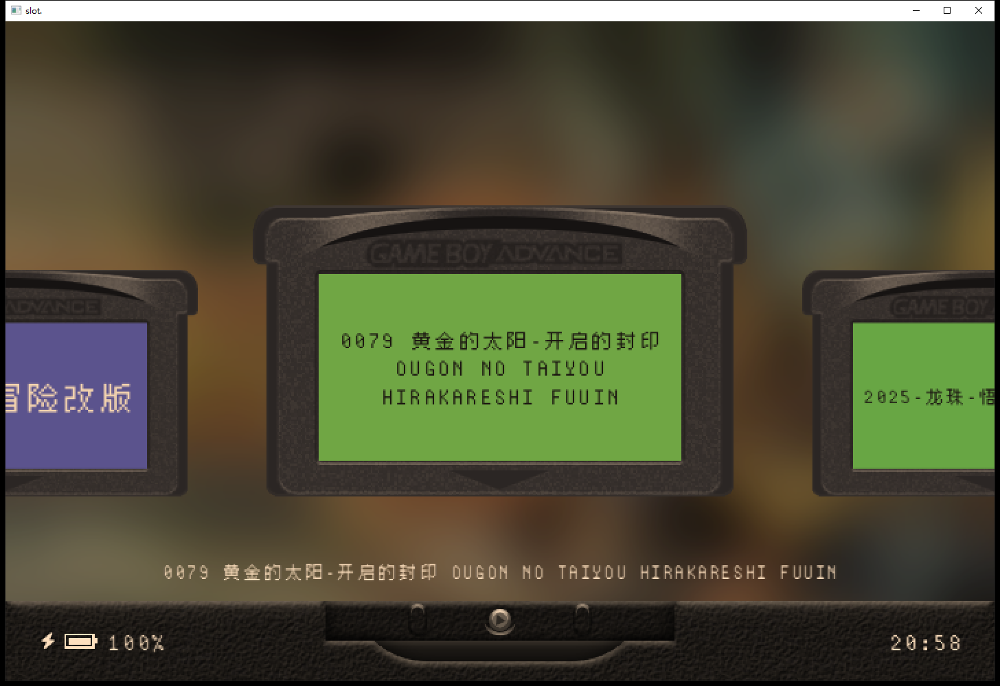
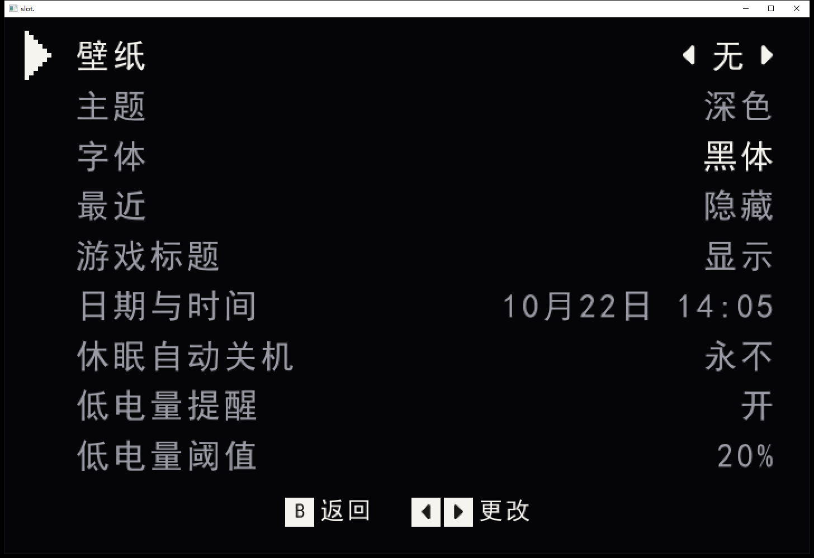
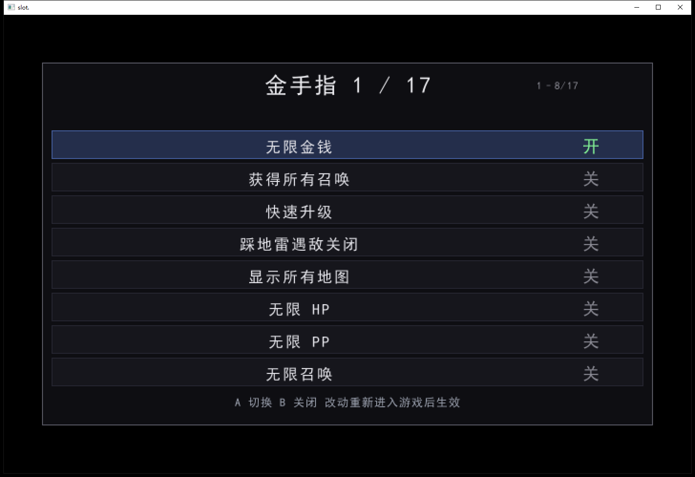
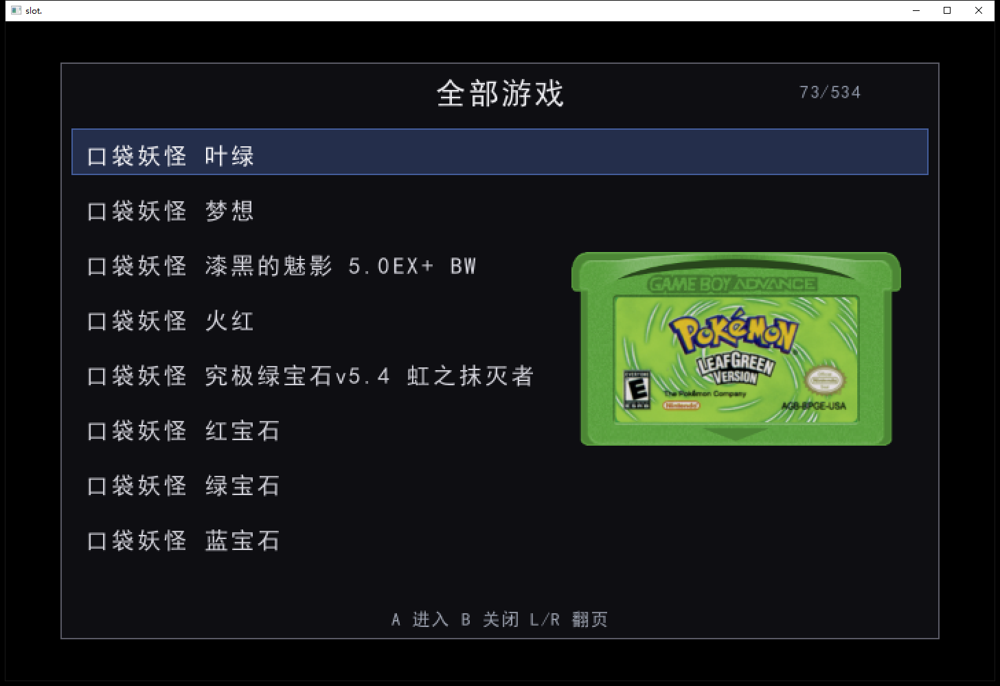
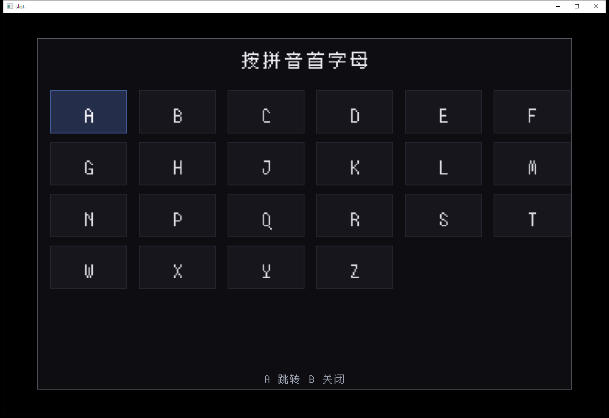
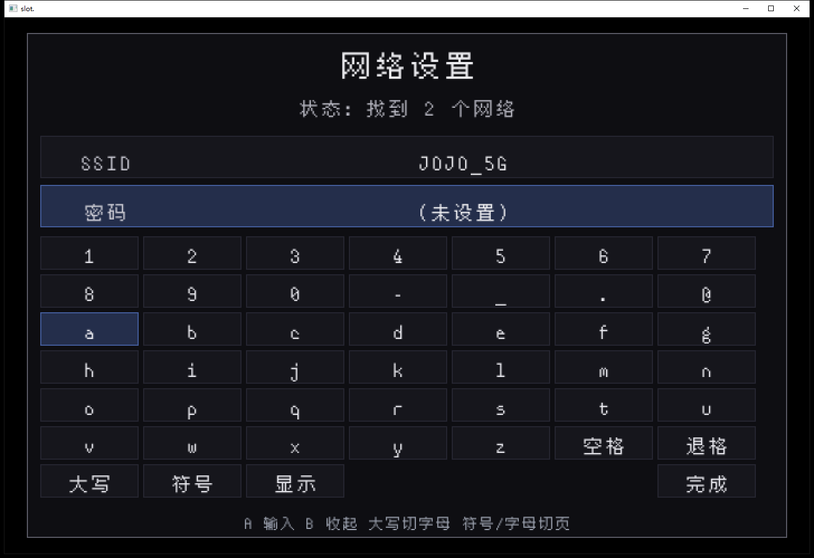
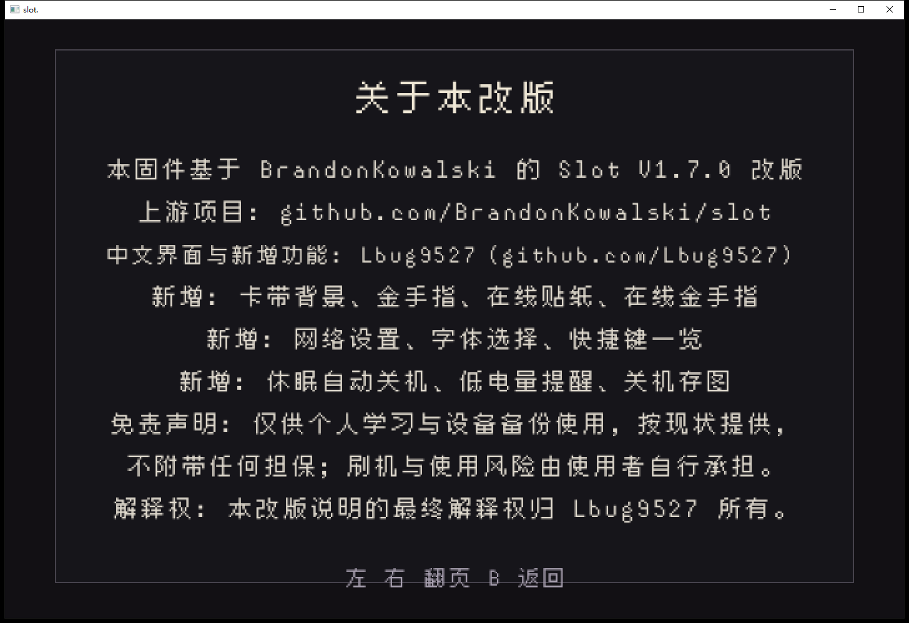

# Slot 简体中文强化版（for Anbernic H700 系列）

基于 [BrandonKowalski/slot](https://github.com/BrandonKowalski/slot) **v1.9.0**（中文界面以「仲冬临沧的十一月」的 1.9.0 汉化 R1 为基底）扩充而来，遵循上游 **GPL-3.0-or-later** 许可。

Slot 是面向 Anbernic H700 掌机的 Game Boy / GBC / GBA 前端，本仓库只做汉化与功能增强，不改变存档/ROM 格式。

> 本项目与 Anbernic、Nintendo 无关；ROM、BIOS 等商业内容请自备合法副本。

**作者：Lbug9527** · https://github.com/Lbug9527

---

## 下载

- 最新固件：[Releases · v1.9.0-zh-1](https://github.com/Lbug9527/slot-zh/releases/tag/v1.9.0-zh-1)
- 压缩包：`slot-v1.9.0-zh-2-h700.zip`（仲冬 10.24 资源 + 本仓库重编的 `System/slot`）
- 系统底座：[BaseOS v1.5.2](https://github.com/pvaibhav/BaseOS/releases) 的 `baseos-rg34xx-1.5.2.bosupd`（放到卡根目录，开机会自动升级）

## 功能

### 界面
- 全中文菜单、设置、查找、关于页；内置像素 CJK 字体
- 字体可选：`System/Fonts/*.ttf|*.otf`，通用页 → 字体
- 日期时间本地化（`10月27日 20:30`）
- 主页 HUD：时间/电量放大、Wi‑Fi 图标（底边与时间对齐）

### 卡带
- 卡带背景：选中卡带用其封面模糊铺底，220ms 交叉淡入
- 收藏（Y）与收藏星标记
- 货架切换：L1 / R1（GBA → GBC → GB）
- 全部游戏列表（Select）：左对齐、收藏星、1 秒后弹出卡带预览（240×141 原比例）、长名滚动 + 两侧渐隐、长按左右连翻

### 查找
- X 打开拼音首字母面板，A–Z 字母表布局
- 支持**多字母前缀与子序列**：`KDYG`、`KYG` 都能到「口袋妖怪」；不匹配时不跳转
- 金手指 / 相册等翻页界面支持长按连续翻页

### 金手指
- 本地：`Cheats/<平台>/<核心>/*.cht`，面板内 A 切换**即时生效**（无需重进游戏），左右翻页
- 在线：按 ROM CRC 匹配 libretro-database，多镜像（jsDelivr / gh-proxy），失败有诊断页

### 在线 / 网络
- Wi‑Fi：扫描列表、软键盘（符号 / 大小写 / 显示密码）、自动连接、记住多个 SSID 密码
- 在线贴纸：Select 下载当前卡带封面
- 失败原因会写到 `Logs/slot.log` 与 `Logs/net-diag.txt`

### 其他
- 休眠自动关机（3 / 10 / 30 分钟 / 永不）
- 低电量提醒（阈值 5%–30% 可调）
- 关机存图：关机前把当前画面存到 `Screenshots/`
- 手柄：支持 gilrs，可映射 Z/C 到菜单/电源

## 截图

## 安装

1. 解压 `slot-v1.9.0-zh-2-h700.zip`，把 `slot-v1.9.0-zh-2/` 里的内容**合并**到 SD 卡根目录（包含 `System/`）
2. 若使用 BaseOS v1.5.2：把 `baseos-rg34xx-1.5.2.bosupd` 放卡根目录，开机等待升级完成（约 30 秒，可能自动重启）
3. 首次启动 Slot 会自动创建目录索引；游戏放 `Games/GBA`、`Games/GB`、`Games/GBC`，封面放 `Labels/`
4. 字体可选：`System/Fonts` 放 ttf/otf

## 支持的机型

本仓库的二进制是 H700 通用 aarch64 包，上游 Slot 1.9.0 已适配：RG34XX、RG34XXSP、RG35XXSP、RG28XX 等；系统底座请按机型下载对应的 BaseOS 镜像。

## 已知限制

- 在线金手指依赖 libretro-database 的 CRC 覆盖，中文改版 ROM 多数查不到
- 在线贴纸按 No-Intro 英文名匹配，中文重命名的 ROM 建议用离线封面
- 内置字体为 Noto Sans CJK SC 子集（OFL-1.1）
- 1.9 的字体行按 A 会进入独立字体页，行内不显示当前字体名

## 免责声明

仅供个人学习与设备备份使用，按现状提供，不附带任何担保；刷机与使用风险由使用者自行承担。

## 致谢

- 上游：[BrandonKowalski/slot](https://github.com/BrandonKowalski/slot)（GPL-3.0）
- 1.9.0 汉化基底：[仲冬临沧的十一月](https://space.bilibili.com/75961128)
- 系统底座：[pvaibhav/BaseOS](https://github.com/pvaibhav/BaseOS)
- 金手指数据：[libretro-database](https://github.com/libretro/libretro-database)
